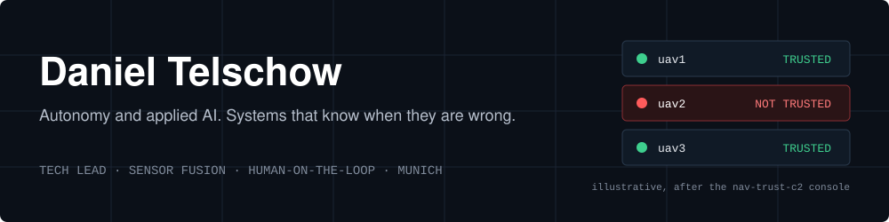
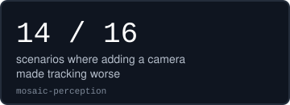
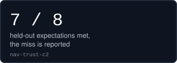
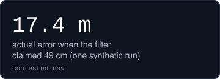
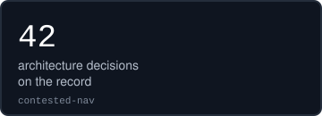
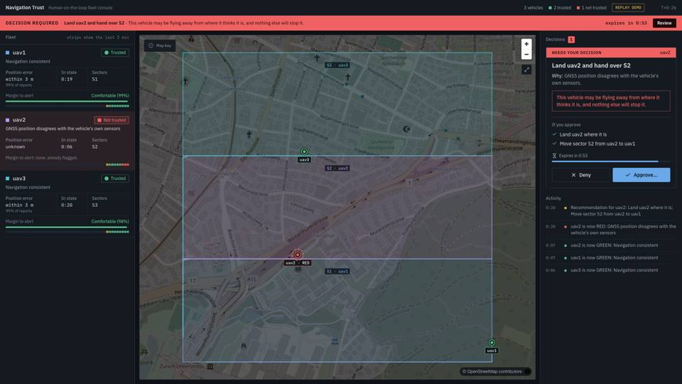
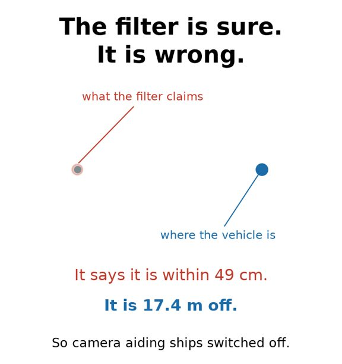
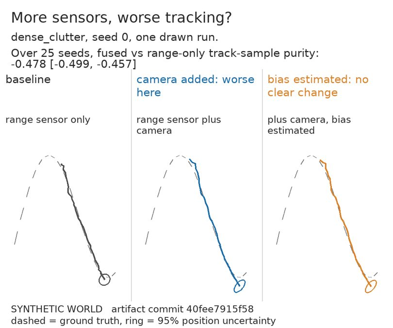

**Technical product and program lead for autonomous systems.** Munich.

In my day job I take automated driving functions from requirements through integration and vehicle validation to release decisions, with engineering teams and external partners. These repositories are where I test the questions behind that work: when does adding a sensor, a camera or an AI component make a system worse, and does the system know it?

## Results

  
  
  
  

All results come from simulation or synthetic data, and each project says so.

## Featured work

<table>
  <tr>
    <td width="300" valign="top"></td>
    <td valign="top">
      <h3><a href="https://github.com/Telschow/nav-trust-c2">nav-trust-c2</a>: which drone's position can the operator trust?</h3>
      
Mission control for a small team of simulated drones. Each vehicle is watched for GNSS loss and frozen positions, shown as GREEN, AMBER or RED with a reason, and the console recommends landing or re-tasking. <b>Nothing executes without a recorded operator approval.</b> <a href="https://youtu.be/L7DrhOYMQ5A">3-minute demo</a>.

      
GNSS loss detected in 1.0 to 1.4 s over 12 runs. The first usability test failed with both participants, so I redesigned the console and published the finding.

      
<code>PX4 / Gazebo / MAVSDK</code> · <code>FastAPI</code> · <code>React / TypeScript</code> · simulation only

    </td>
  </tr>
  <tr>
    <td width="300" valign="top"></td>
    <td valign="top">
      <h3><a href="https://github.com/Telschow/contested-nav">contested-nav</a>: is the filter right about how wrong it is?</h3>
      
A 21-state error-state Kalman filter and evaluation harness for <b>GNSS-denied navigation</b>. With GNSS denied and camera aiding on, the filter claims centimetres while its error is metres, so <b>vision ships off by default</b>.

      
When I found a flaw in my own benchmark, I retracted the earlier result, fixed the method and set the bar for the next claim before running it. No candidate met the bar, so I closed the question (<a href="https://github.com/Telschow/contested-nav/blob/main/docs/adr/0036-b1-is-closed-as-characterised-not-solved.md">ADR-0036</a>).

      
<code>state estimation</code> · <code>fault detection</code> · <code>uncertainty calibration</code> · <code>Python</code> · synthetic and recorded data

    </td>
  </tr>
  <tr>
    <td width="300" valign="top"></td>
    <td valign="top">
      <h3><a href="https://github.com/Telschow/mosaic-perception">mosaic-perception</a>: when does fusing sensors make tracking worse?</h3>
      
A deterministic multi-sensor tracking workbench with paired comparisons. Adding a camera made tracking worse in 14 of 16 scenarios, and an ablation traces most of that to one tracker design choice, not to fusion in general.

      
<code>multi-target tracking</code> · <code>sensor fusion</code> · <code>Python / Streamlit</code> · synthetic

    </td>
  </tr>
</table>

## How I work

* **Decisions are written down** as architecture decision records, so a team can disagree with them for the right reasons later.
* **Claims are earned by measurement.** Numbers in the docs are generated and checked in CI, and misses stay in the headline.
* **I set the bar before the test, and stop when it is not met.**
* **AI-assisted engineering with gates, not trust.** Most code here is written by an AI coding agent, and each README says so. I set scope and requirements, make the decisions, review and merge. Tests, held-out protocols and security scans keep it honest.
* **Safety and scope are part of the design:** human approval by default, documented non-goals.

Python · TypeScript · state estimation · sensor fusion · PX4 SITL · FastAPI · React · RAG and agent evaluation · GitHub Actions

<a href="https://linkedin.com/in/dtelschow">LinkedIn</a>
